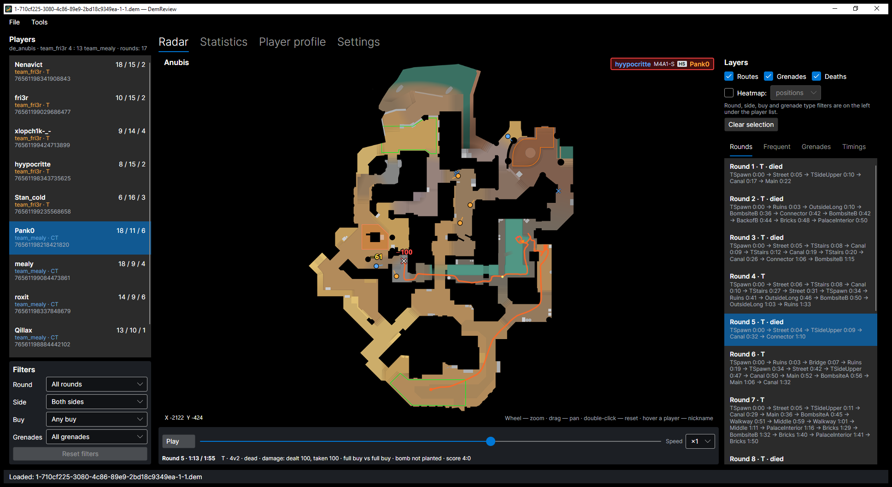
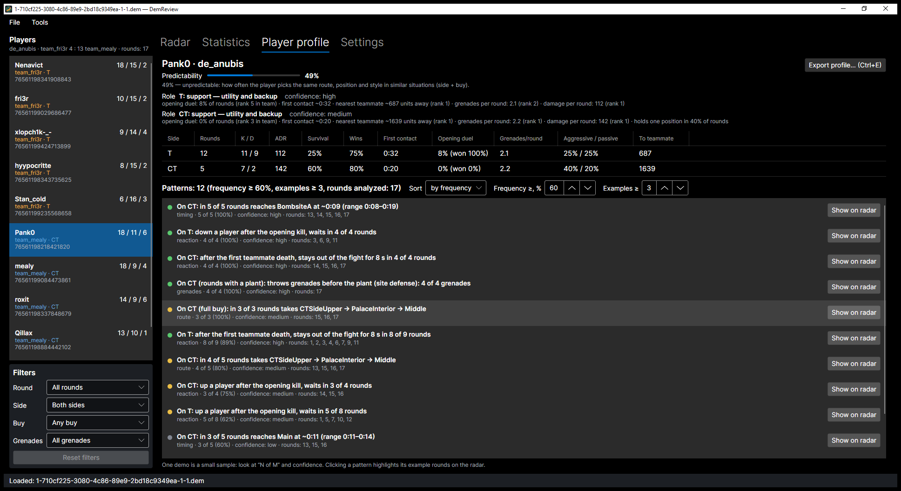
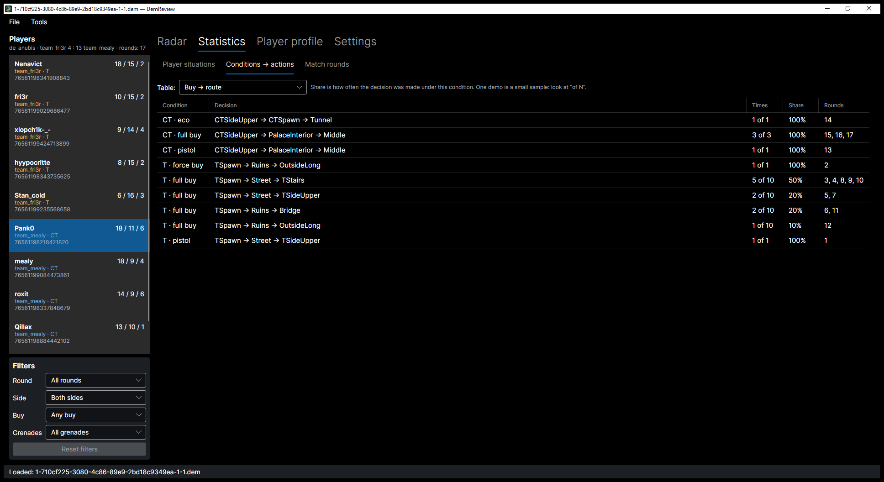

# DemReview

**English** · [Русский](README.ru.md)

DemReview is a desktop app that analyzes how **one specific player** behaves in a Counter-Strike 2 demo (`.dem`):
where they go, which grenades they throw, how they react to the situation in a round, and which habits repeat
often enough to be predictable. It works fully offline on Windows and Linux.


## What it shows

- **Radar.** Every route of the player on the map background, grenades from throw to detonation (smoke and fire
  areas), deaths, heatmaps of positions or deaths. Zoom with the wheel, pan by dragging.
- **Round replay.** Timeline with playback (×0.5–×8): all players with view direction, nickname on hover,
  a game-style kill feed (the player's kills and death are highlighted), damage pop-ups over victims
  (dealt — yellow, taken — red), grenade damage at the explosion, and the context of the moment: players alive,
  money, buys, bomb, score.
- **Filters.** Round, side, team buy (pistol, eco, force, full buy), grenade type.
- **Statistics.** Each round as "conditions → decision": side, buy and score versus route, final position,
  grenades, aggression, opening duel, damage. Frequency tables show how often each decision follows each condition.
- **Player profile.** Role on each side with reasons, stable patterns ("On T (full buy): in 7 of 9 rounds takes
  TSpawn → SideAlley → TopofMid"), confidence that accounts for the small sample of one demo, ADR and a
  predictability index. One click shows a pattern's example rounds on the radar.
- **Export** of the profile to Markdown or JSON.
- **Russian and English** interface.

| Round replay | Player profile |
|---|---|
|  |  |



## Download

Get the latest build from [Releases](../../releases/latest). Builds are self-contained: .NET is not required.

- **Windows 10/11 x64:** unpack `DemReview-<version>-win-x64.zip` and run `DemReview.exe`.
  The app is not code-signed, so Windows SmartScreen may warn on first start: *More info → Run anyway*.
- **Linux x64:** unpack and run:
  ```bash
  tar -xzf DemReview-<version>-linux-x64.tar.gz
  ./DemReview-<version>-linux-x64/DemReview
  ```
  A desktop session with X11 or XWayland is required.

Each release has `SHA256SUMS.txt` to verify the downloads.

## How to use

1. **Open a demo:** *File → Open demo* (Ctrl+O), drag a `.dem` file onto the window, or pass the path on the
   command line (on Windows you can use *Open with → DemReview*). Parsing runs in the background and can be
   cancelled with Esc.
2. **Pick a player** in the list on the left. All tabs now show this player.
3. **Radar.** Layers are toggled on the right. Select a round in the *Rounds* list (or in the round filter) to open
   the timeline: press *Play* or drag the slider. Hover a player to see the nickname, weapon and HP.
   The *Frequent*, *Grenades* and *Timings* lists highlight their rounds and lineups on the radar.
4. **Statistics.** *Player situations* lists every round; *Conditions → actions* shows frequency tables;
   *Match rounds* shows the buys of both teams.
5. **Player profile.** Patterns are shown when they happen in at least 60% of cases and in at least 3 rounds;
   both thresholds can be changed on the tab. Watch "N of M" and the confidence dot (green — high, yellow — medium,
   grey — low): one demo is a small sample. *Show on radar* overlays the example rounds.
6. **Export** the profile with Ctrl+E: the format follows the file type (`.md` or `.json`), the text follows the
   interface language.
7. **Settings:** interface language, the parsed demo cache (size, clearing), data and map folders, update check.

### Keyboard shortcuts

| Keys | Action |
|---|---|
| Ctrl+O | Open demo |
| Ctrl+E | Export player profile |
| F5 | Analyze again |
| Shift+F5 | Reparse the demo, skipping the cache |
| Esc | Cancel parsing |

### Maps

Radar images and coordinates are included for de_mirage, de_inferno, de_dust2, de_nuke, de_ancient, de_anubis,
de_train and de_overpass (coordinates are verified on real demos for Mirage and Anubis). Other maps are drawn
on a grid with the scale fitted to player positions. How to add a map: [`maps/README.txt`](maps/README.txt).

### Data and settings

User data lives in `%LOCALAPPDATA%\DemReview` on Windows and `~/.local/share/DemReview` on Linux:

- `settings.json` — settings and window placement;
- `demreview.db` — cache of parsed demos (SQLite, last 50; safe to delete or clear in *Settings*);
- `logs/` — logs for the last 14 days.

Analysis thresholds can be tuned in `settings.json`:

| Key | Default | Meaning |
|---|---|---|
| `Language` | — | `ru` or `en`; empty — ask on start |
| `CheckForUpdates` | `true` | Check GitHub for a new release on start |
| `SampleTickStep` | 16 | Position sampling step, ticks (8–16) |
| `GrenadeClusterThrowDistance` | 150 | Max distance between throw points in one lineup, units |
| `GrenadeClusterLandDistance` | 250 | Max distance between detonation points in one lineup, units |
| `BuyEcoMaxEquipment` | 1500 | Average equipment below this — eco, $ |
| `BuyFullMinEquipment` | 3700 | Average equipment from this — full buy, $ (in between — force) |
| `AggressiveContactSeconds` | 20 | First fight no later than this — aggressive round, s |
| `PassiveContactSeconds` | 50 | First fight no earlier than this (or none) — passive round, s |
| `PatternMinShare` | 0.6 | Minimum pattern frequency |
| `PatternMinExamples` | 3 | Minimum example rounds of a pattern |

### Updates and privacy

DemReview does not send your data anywhere. The only network request is an optional check of the latest
release on GitHub at start (*Settings → Updates*). When a new version is out, a banner links to the release page;
updates are installed manually by downloading the new build.

## Building from source

Requires the [.NET 10 SDK](https://dotnet.microsoft.com/download).

```bash
git clone <repository url>
cd demreview
dotnet build DemReview.slnx
dotnet test --solution DemReview.slnx
dotnet run --project src/DemReview.Desktop -- "path/to/demo.dem"
```

NuGet packages are restored into `.nuget/packages` inside the repository (see `nuget.config`).
Tests that need real demos take them from `samples/` (not in the repository) and are skipped without it.

Self-contained single-file builds go to `artifacts/<rid>/`:

```bash
./publish.sh             # win-x64 and linux-x64; or: ./publish.sh linux-x64
```
```powershell
.\publish.ps1            # win-x64 and linux-x64; or: .\publish.ps1 win-x64
```

### Project structure

| Project | Purpose |
|---|---|
| `DemReview.Domain` | Immutable models: match, rounds, players, position samples, grenades, events |
| `DemReview.Application` | Analysis: routes, grenades, damage, round context and economy, conditions → actions, heatmaps, filters, patterns, export, localization |
| `DemReview.Infrastructure` | Demo parsing with [DemoFile.Net](https://github.com/saul/demofile-net), map data, SQLite cache (EF Core), settings, update check, platform services |
| `DemReview.Desktop` | Avalonia UI (MVVM with CommunityToolkit.Mvvm), radar control, DI host |
| `DemReview.Tests` | xUnit v3 tests |

Code comments and design notes ([docs/PLAN.md](docs/PLAN.md)) are in Russian.

### Releasing

1. Update `Version` in `Directory.Build.props` and add a section to [CHANGELOG.md](CHANGELOG.md).
2. Push a tag: `git tag v0.2.0 && git push origin v0.2.0`.
3. GitHub Actions runs the tests, builds the Windows and Linux archives and creates a **draft** release.
4. Review the draft on the Releases page and publish it.

## License

[MIT](LICENSE). Third-party components and the map images (© Valve Corporation) are listed in
[THIRD-PARTY-NOTICES.md](THIRD-PARTY-NOTICES.md). DemReview is not affiliated with or endorsed by Valve.
