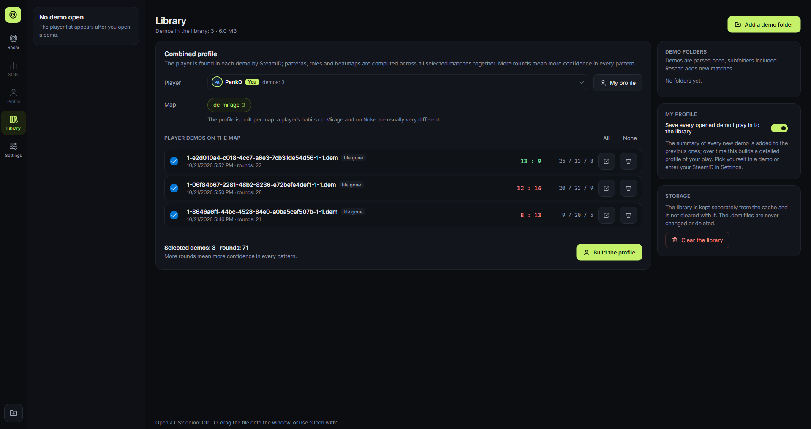
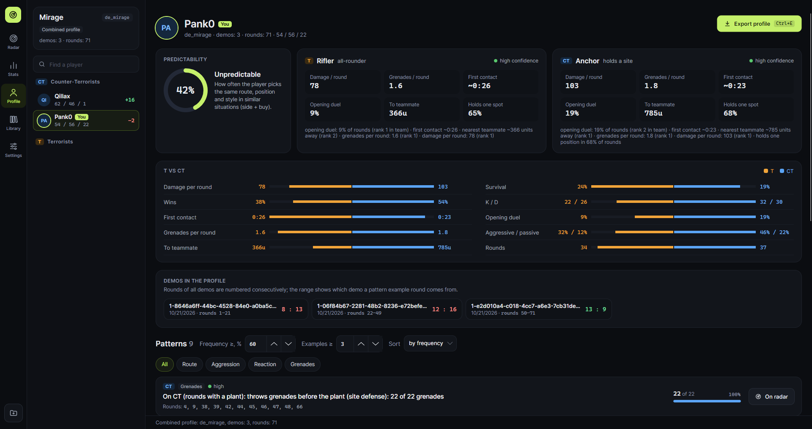
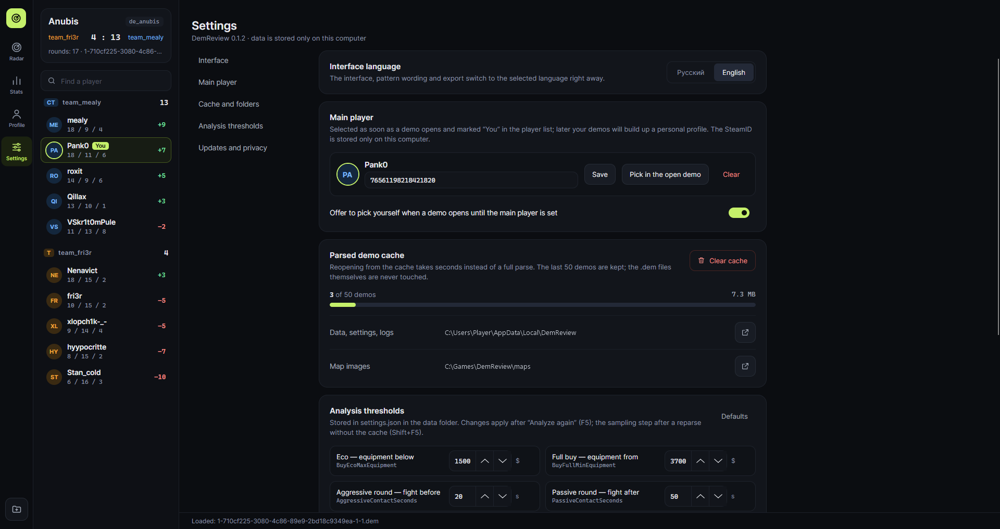

# DemReview

**English** · [Русский](README.ru.md) · [Website](https://pank0rekt.github.io/demreview-cs2/) · [Telegram](https://t.me/demreview)

DemReview is a desktop app that analyzes how **one specific player** behaves in a Counter-Strike 2 demo (`.dem`):
where they go, which grenades they throw, how they react to the situation in a round, and which habits repeat
often enough to be predictable. One demo is a small sample, so DemReview can also build a combined profile from many
demos of the same player and keep your own profile that grows with every match. It works offline on Windows and Linux.


> **About the project.** DemReview is a pet project built with the help of [Claude Code](https://claude.com/claude-code).
> It is fully open source under the [MIT License](LICENSE) and is maintained by me
> ([@Pank0REKT](https://github.com/Pank0REKT)). Bug reports go to [Issues](../../issues), ideas and suggestions — to [Discussions](https://github.com/Pank0REKT/demreview-cs2/discussions/1).
> News and updates are posted in the [Telegram channel](https://t.me/demreview).

## What it shows

- **Players.** Both teams side by side with K / D / A, the kill-death difference and a search by nickname;
  you are marked *You*.
- **Radar.** Every route of the player on the map background, grenades from throw to detonation (smoke and fire
  areas), deaths, heatmaps of positions or deaths. Zoom with the wheel or the +/− buttons, pan by dragging.
- **Round replay.** Timeline with playback (×0.5–×8): all players with view direction, nickname on hover,
  a game-style kill feed (the player's kills and death are highlighted), damage pop-ups over victims
  (dealt — yellow, taken — red), grenade damage at the explosion, and the context of the moment: players alive,
  money, buys, bomb, score.
- **Filters.** Round, side, team buy (pistol, eco, force, full buy), grenade type.
- **Statistics.** Summary tiles (rounds, wins, damage per round, first contact — overall and per side) and each round
  as "conditions → decision": side, buy and score versus route, final position, grenades, aggression, opening duel,
  damage. Frequency tables show how often each decision follows each condition.
- **Player profile.** Predictability index, role on each side with key metrics and reasons, a T vs CT comparison,
  stable patterns ("On T (full buy): in 7 of 9 rounds takes TSpawn → SideAlley → TopofMid") filtered by category,
  with confidence that accounts for the small sample of one demo. One click shows a pattern's example rounds on the radar.
- **Grenades.** Which grenades paid off: HE and fire damage to enemies (per grenade too), enemies and teammates blinded
  by each flash and for how long, kills of flashed enemies while they were still blind, team damage. A table compares
  all players of the match, and every throw of the player shows its outcome. One click opens the throw on the radar
  timeline a couple of seconds before it, paused, to watch the grenade fly.
- **Lineup library.** Save the throws you like: position, angle and how it was thrown (jump throw, crouching, walking).
  One button copies `setpos` / `setang` so you can stand on the spot on your own server and practice the throw.
- **Self-review.** Moments worth rewatching: deaths that weren't traded, deaths alone far from the team, deaths with
  unused grenades (and how much money was lost), re-peeks after a won duel. One button copies `demo_gototick` with
  the right tick, so you watch exactly that moment in CS2. Clutches, retakes and post-plants: where the player stands
  and how often the round is won. Duels: wins and losses by distance, weapon and side of the angle (peeking or holding).
- **Library and the profile across many demos.** Add a folder with demos and DemReview parses each one once and keeps
  the analysis. Pick a player (found in every demo by SteamID), a map and the demos, and patterns, roles, the radar and
  heatmaps are computed across all the rounds together. The profile is built from the library in seconds, even if the
  `.dem` files are gone.
- **My profile.** Every demo you open that you played in is saved to the library automatically, so your own profile
  grows with each match.
- **Export** of the profile to Markdown or JSON.
- **Settings** right in the app, analysis thresholds included.
- **Russian and English** interface.

| Library | Combined profile across 3 demos |
|---|---|
|  |  |
| **Round replay** | **Player profile** |
|  |  |
| **Statistics** | **Settings** |
|  |  |

## Download

Get the latest build from [Releases](../../releases/latest). Builds are self-contained: .NET is not required.

- **Windows 10/11 x64:** unpack `DemReview-<version>-win-x64.zip` and run `DemReview.exe`.
  The app is not code-signed, so Windows SmartScreen may warn on first start: *More info → Run anyway*.
- **Linux x64:** unpack and run:
  ```bash
  tar -xzf DemReview-<version>-linux-x64.tar.gz
  ./DemReview-<version>-linux-x64/DemReview
  ```
  A desktop session with X11 or XWayland is required.

Each release has `SHA256SUMS.txt` to verify the downloads.

## How to use

The window has a section bar on the far left (*Radar*, *Stats*, *Profile*, *Grenades*, *Review*, *Library*, *Settings*;
at the bottom — the Telegram channel and the open-demo button), the match and its players next to it, and the selected
section on the right.

1. **Open a demo:** the *Open demo* button (Ctrl+O), drag a `.dem` file onto the window, or pass the path on the
   command line (on Windows you can use *Open with → DemReview*). Parsing runs in the background with progress at
   the bottom of the window and can be cancelled with Esc.
2. **Pick a player** in the player panel: teams are listed separately, and the search box finds a nickname. All sections
   now show this player. On the first demo DemReview offers to pick yourself as the *main player*: from then on you are
   selected as soon as a demo opens and marked *You* in the list (you can also enter your SteamID in Settings).
3. **Radar.** Filters (side, round, buy, grenades) are above the map, layers are toggled on the right. Select a round
   in the *Rounds* list (or in the round filter) to open the timeline: press play or drag the slider, pick the speed.
   Hover a player to see the nickname, weapon and HP. The *Frequent*, *Grenades* and *Timings* tabs highlight their
   rounds and lineups on the radar.
4. **Statistics.** Tiles sum up the rounds, wins, damage and first contact; side and buy are switched right on the page.
   *Player situations* lists every round; *Conditions → actions* shows frequency tables; *Match rounds* shows the buys
   of both teams.
5. **Player profile.** Patterns are shown when they happen in at least 60% of cases and in at least 3 rounds;
   both thresholds can be changed on the page or in Settings. Watch "N of M" and the confidence dot (green — high,
   yellow — medium, grey — low): one demo is a small sample. Category chips narrow the list; clicking a pattern
   highlights its example rounds, *On radar* also switches to the radar.
6. **Export** the profile with Ctrl+E or the *Export profile* button: the format follows the file type
   (`.md` or `.json`), the text follows the interface language.
7. **Grenades.** Tiles show the player's HE and fire damage, enemies blinded, kills of flashed enemies and teammates
   blinded; the table below compares all players of the match. In *Player throws* every throw shows where it landed and
   what it did. The buttons next to a throw (here and in the radar's *Grenades* tab):
   - ▶ opens the round on the radar timeline 2 s before the throw, paused: press play to watch it fly;
   - copy puts `setpos x y z;setang pitch yaw 0` on the clipboard: paste it into the console of your own server
     with `sv_cheats 1` and you stand on the throw spot with the same aim;
   - bookmark saves the throw to the *Lineup library* on the right. Lineups are filtered by map and grenade type
     and can be renamed.

   How the player moved during the throw is recorded since v0.3.0; demos parsed earlier show it after a reparse (Shift+F5).
8. **Review.** Tiles sum up the player's mistakes, clutches and duels. Three tabs:
   - *Mistakes* — deaths with questionable moments, filtered by kind: *Not traded* (nobody killed the killer within 5 s
     although teammates were alive), *Alone* (the nearest living teammate was over ~29 m away), *Unused grenades*
     (which ones and how much they cost), *Re-peek* (died on the same spot within 4 s of their own kill);
   - *Clutches and the bomb* — clutches (by matchup: 1v1, 1v2…), post-plants and retakes: each round with the
     player's position and the outcome, and a table of positions with the round win rate;
   - *Duels* — wins and losses by distance, weapon class, weapon and side of the angle (peeking — the player moved
     in the last second before the duel, holding — stood still).

   Next to every moment: ▶ opens it on the radar timeline, paused; copy puts `demo_gototick N` on the clipboard —
   open the same demo in CS2 and paste the command into the console to watch the moment (5 s before a death,
   2 s before a clutch or a plant). Unused grenades and demo ticks are recorded since v0.4.0; demos parsed earlier
   show them after a reparse (Shift+F5).
9. **Library.** *Add a demo folder* parses every `.dem` in it (subfolders included) into the library; *Rescan* adds new
   and changed demos from all folders. Pick a player (*My profile* selects you) and a map: the list shows the player's
   demos there with the score from their side and K / D / A. Tick the demos and press *Build the profile*: all sections
   (radar, statistics, profile) now show the combined match, with rounds numbered consecutively; the *Demos in the
   profile* card shows which rounds come from which demo. The profile is built per map, since habits differ from map
   to map. A single demo opens from the list too, from the file or, if it is gone, from the saved analysis.
10. **Settings:** interface language, main player (your SteamID), the parsed demo cache (fill level, clearing), data and
   map folders, analysis thresholds, update check, usage statistics.

### Keyboard shortcuts

| Keys | Action |
|---|---|
| Ctrl+O | Open demo |
| Ctrl+E | Export player profile |
| F5 | Analyze again |
| Shift+F5 | Reparse the demo, skipping the cache |
| Esc | Cancel parsing |

### Maps

Radar images and coordinates are included for 23 maps:

- **Active Duty and classics:** de_mirage, de_inferno, de_dust2, de_nuke, de_ancient, de_anubis, de_train, de_overpass,
  de_vertigo, de_cache, de_dust, de_ancient_night;
- **Hostage:** cs_office, cs_italy, cs_shelter;
- **Other modes and community maps:** de_boulder, de_debris, de_eldorado, de_fachwerk, de_poseidon, ar_baggage, ar_shoots,
  ar_shoots_night.

Coordinates come from the game's overview files; they are verified on real demos for Mirage, Anubis and Cache.
Other maps are drawn on a grid with the scale fitted to player positions. How to add a map: [`maps/README.txt`](maps/README.txt).

### Data and settings

User data lives in `%LOCALAPPDATA%\DemReview` on Windows and `~/.local/share/DemReview` on Linux:

- `settings.json` — settings, analysis thresholds and window placement;
- `demreview.db` — cache of parsed demos (SQLite, last 50; safe to delete or clear in *Settings*);
- `library.db` — the demo library for combined profiles (SQLite, no limit, not cleared with the cache; cleared on the
  *Library* page). The `.dem` files themselves are never changed or deleted;
- `lineups.json` — the lineup library (kept separately from the cache and the demo library);
- `logs/` — logs for the last 14 days.

Analysis thresholds are edited in *Settings → Analysis thresholds* (applied after *Analyze again*, F5; the sampling
step after a reparse, Shift+F5) or directly in `settings.json`:

| Key | Default | Meaning |
|---|---|---|
| `Language` | — | `ru` or `en`; empty — ask on start |
| `CheckForUpdates` | `true` | Check GitHub for a new release on start |
| `SendUsageStatistics` | `true` | Send anonymous usage statistics (app start, demo load) |
| `MainPlayerSteamId` | — | Your SteamID64: selected automatically and marked *You* in the player list |
| `MainPlayerPromptDisabled` | `false` | Do not offer to pick yourself when a demo opens |
| `DemoFolders` | `[]` | Demo folders of the library: *Rescan* parses new demos from them |
| `SaveMyDemosToLibrary` | `true` | Save every opened demo where the main player plays to the library |
| `SampleTickStep` | 16 | Position sampling step, ticks (8–16) |
| `GrenadeClusterThrowDistance` | 150 | Max distance between throw points in one lineup, units |
| `GrenadeClusterLandDistance` | 250 | Max distance between detonation points in one lineup, units |
| `BuyEcoMaxEquipment` | 1500 | Average equipment below this — eco, $ |
| `BuyFullMinEquipment` | 3700 | Average equipment from this — full buy, $ (in between — force) |
| `AggressiveContactSeconds` | 20 | First fight no later than this — aggressive round, s |
| `PassiveContactSeconds` | 50 | First fight no earlier than this (or none) — passive round, s |
| `PatternMinShare` | 0.6 | Minimum pattern frequency |
| `PatternMinExamples` | 3 | Minimum example rounds of a pattern |

### Updates and privacy

DemReview never sends your demos, files or player data. There are two network requests, both optional; without
a network the app works as usual:

- **Update check** — the latest release on GitHub is checked at start (*Settings → Updates and privacy*). When a new version
  is out, a banner links to the release page; updates are installed manually by downloading the new build.
- **Anonymous usage statistics** via [Aptabase](https://aptabase.com) — helps to see how many people use the app.
  Only two events are sent: app start and demo load (map, cache or parse, parse time), plus the app version, OS
  and system language. File names, nicknames, SteamIDs and a persistent user ID are never sent. Turn it off with
  the switch in *Settings → Updates and privacy*. Only release builds send statistics; builds from source have no
  key and it is off.

## Building from source

Requires the [.NET 10 SDK](https://dotnet.microsoft.com/download).

```bash
git clone https://github.com/Pank0REKT/demreview-cs2.git
cd demreview-cs2
dotnet build DemReview.slnx
dotnet test --solution DemReview.slnx
dotnet run --project src/DemReview.Desktop -- "path/to/demo.dem"
```

NuGet packages are restored into `.nuget/packages` inside the repository (see `nuget.config`).
Tests that need real demos take them from `samples/` (not in the repository) and are skipped without it.

Self-contained single-file builds go to `artifacts/<rid>/`:

```bash
./publish.sh             # win-x64 and linux-x64; or: ./publish.sh linux-x64
```
```powershell
.\publish.ps1            # win-x64 and linux-x64; or: .\publish.ps1 win-x64
```

### Project structure

| Project | Purpose |
|---|---|
| `DemReview.Domain` | Immutable models: match, rounds, players, position samples, grenades, events |
| `DemReview.Application` | Analysis: routes, grenades and their effectiveness, lineups, damage, round context and economy, conditions → actions, heatmaps, filters, patterns, self-review (mistakes, clutches, duels), merging demos into a combined match, export, localization |
| `DemReview.Infrastructure` | Demo parsing with [DemoFile.Net](https://github.com/saul/demofile-net), map data, SQLite cache and demo library (EF Core), lineup library (JSON), settings, update check, platform services |
| `DemReview.Desktop` | Avalonia UI (MVVM with CommunityToolkit.Mvvm), radar control, DI host |
| `DemReview.Tests` | xUnit v3 tests |

Code comments are in Russian.

### Releasing

1. Update `Version` in `Directory.Build.props` and add a section to [CHANGELOG.md](CHANGELOG.md).
2. Push a tag: `git tag v0.2.0 && git push origin v0.2.0`.
3. GitHub Actions runs the tests, builds the Windows and Linux archives and creates a **draft** release.
4. Review the draft on the Releases page and publish it.

## License

[MIT](LICENSE). Third-party components and the map images (© Valve Corporation) are listed in
[THIRD-PARTY-NOTICES.md](THIRD-PARTY-NOTICES.md). DemReview is not affiliated with or endorsed by Valve.
