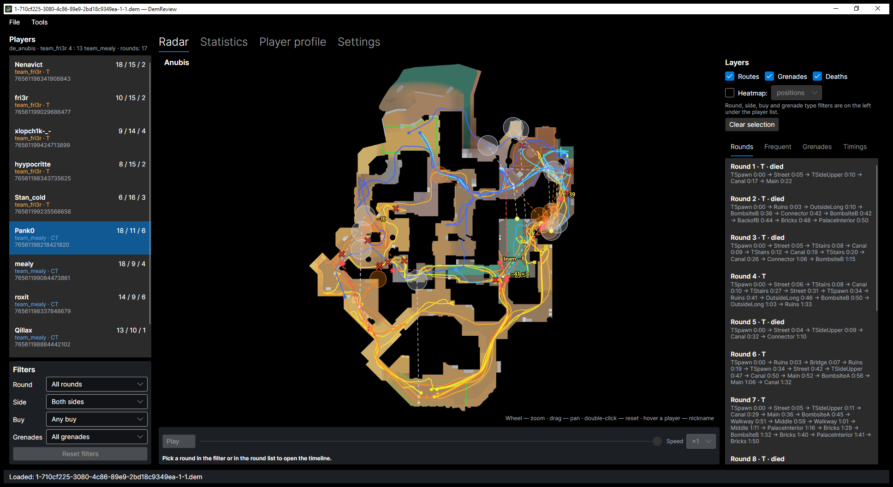

# DemReview

[English](README.md) · **Русский** · [Сайт](https://pank0rekt.github.io/demreview-cs2/)

DemReview — десктопное приложение для анализа поведения **конкретного игрока** по демке Counter-Strike 2 (`.dem`):
как он перемещается по карте, какие гранаты кидает, как реагирует на ситуацию в раунде и какие привычки
повторяются настолько часто, что становятся предсказуемыми. Работает офлайн на Windows и Linux.



> **О проекте.** DemReview — пет-проект, сделанный с помощью [Claude Code](https://claude.com/claude-code).
> Он полностью открытый (open source, [лицензия MIT](LICENSE)) и поддерживается мной
> ([@Pank0REKT](https://github.com/Pank0REKT)). Сообщения об ошибках и идеи — в [Issues](../../issues).

## Что показывает

- **Радар.** Все маршруты игрока на подложке карты, гранаты от броска до детонации (зоны дыма и огня), смерти,
  тепловые карты позиций или смертей. Зум колесом, сдвиг перетаскиванием.
- **Повтор раунда.** Таймлайн с воспроизведением (×0,5–×8): все игроки с направлением взгляда, ник при наведении
  мышью, киллфид как в игре (убийства и смерть игрока выделены), всплывающий урон над жертвами
  (нанесённый — жёлтый, полученный — красный), урон гранат у места взрыва и контекст момента: живые, деньги,
  закупки, бомба, счёт.
- **Фильтры.** Раунд, сторона, закупка команды (пистолетка, эко, форс, фулл-бай), тип гранаты.
- **Статистика.** Каждый раунд как «условия → решение»: сторона, закупка и счёт против маршрута, итоговой позиции,
  гранат, агрессии, первой дуэли, урона. Частотные таблицы показывают, как часто решение следует за условием.
- **Профиль игрока.** Роль на каждой стороне с обоснованием, устойчивые паттерны («На T при закупке «фулл-бай»
  в 7 из 9 раундов идёт TSpawn → SideAlley → TopofMid»), уверенность с учётом малой выборки одной демки,
  ADR и индекс предсказуемости. Клик — раунды-примеры паттерна на радаре.
- **Экспорт** профиля в Markdown или JSON.
- **Интерфейс на русском и английском.**

## Скачать

Последняя сборка — на странице [Releases](../../releases/latest). Сборки самодостаточные: .NET ставить не нужно.

- **Windows 10/11 x64:** распакуйте `DemReview-<версия>-win-x64.zip` и запустите `DemReview.exe`.
  Программа не подписана, поэтому SmartScreen может предупредить при первом запуске:
  «Подробнее → Выполнить в любом случае».
- **Linux x64:** распакуйте и запустите:
  ```bash
  tar -xzf DemReview-<версия>-linux-x64.tar.gz
  ./DemReview-<версия>-linux-x64/DemReview
  ```
  Нужен графический сеанс с X11 или XWayland.

К каждому релизу приложен `SHA256SUMS.txt` для проверки файлов.

## Как пользоваться

1. **Откройте демку:** «Файл → Открыть демку» (Ctrl+O), перетащите `.dem` на окно или передайте путь в командной
   строке (на Windows — «Открыть с помощью → DemReview»). Разбор идёт в фоне, отмена — Esc.
2. **Выберите игрока** в списке слева. Все вкладки показывают этого игрока.
3. **Радар.** Слои включаются справа. Выберите раунд в списке «Раунды» (или в фильтре раунда) — появится таймлайн:
   «Пуск» или ползунок. Наведите мышь на игрока — ник, оружие, HP. Списки «Частые», «Гранаты» и «Тайминги»
   подсвечивают свои раунды и раскидки на радаре.
4. **Статистика.** «Ситуации игрока» — все раунды; «Условия → действия» — частотные таблицы;
   «Раунды матча» — закупки обеих команд.
5. **Профиль игрока.** Паттерн показывается, если встречается не реже 60% случаев и минимум в 3 раундах; оба порога
   меняются на вкладке. Смотрите на «N из M» и цвет точки уверенности (зелёный — высокая, жёлтый — средняя,
   серый — низкая): одна демка — малая выборка. «Показать на радаре» накладывает раунды-примеры.
6. **Экспорт** профиля — Ctrl+E: формат по типу файла (`.md` или `.json`), текст — на языке интерфейса.
7. **Настройки:** язык интерфейса, кеш разобранных демок (размер, очистка), папки данных и карт, проверка обновлений, статистика использования.

### Горячие клавиши

| Клавиши | Действие |
|---|---|
| Ctrl+O | Открыть демку |
| Ctrl+E | Экспорт профиля игрока |
| F5 | Повторный анализ |
| Shift+F5 | Разобрать демку заново (без кеша) |
| Esc | Отменить разбор |

### Карты

Изображения радаров и координаты включены для de_mirage, de_inferno, de_dust2, de_nuke, de_ancient, de_anubis,
de_train, de_overpass, de_vertigo и de_cache (координаты сверены на реальных демках для Mirage и Anubis). Остальные карты рисуются
на сетке с масштабом по позициям игроков. Как добавить карту — [`maps/README.txt`](maps/README.txt).

### Данные и настройки

Каталог данных: Windows — `%LOCALAPPDATA%\DemReview`, Linux — `~/.local/share/DemReview`.

- `settings.json` — настройки, размер и положение окна;
- `demreview.db` — кеш разобранных демок (SQLite, последние 50; можно удалить или очистить в «Настройках»);
- `logs/` — журналы за 14 дней.

Пороги анализа настраиваются в `settings.json`:

| Ключ | По умолчанию | Смысл |
|---|---|---|
| `Language` | — | `ru` или `en`; нет значения — спросить при запуске |
| `CheckForUpdates` | `true` | Проверять новый релиз на GitHub при запуске |
| `SendUsageStatistics` | `true` | Отправлять анонимную статистику (запуск, загрузка демки) |
| `SampleTickStep` | 16 | Шаг выборки позиций, тиков (8–16) |
| `GrenadeClusterThrowDistance` | 150 | Порог точек броска в одной раскидке, units |
| `GrenadeClusterLandDistance` | 250 | Порог точек детонации в одной раскидке, units |
| `BuyEcoMaxEquipment` | 1500 | Средняя экипировка ниже — эко, $ |
| `BuyFullMinEquipment` | 3700 | Средняя экипировка не ниже — фулл-бай, $ (между — форс) |
| `AggressiveContactSeconds` | 20 | Первый бой не позже — агрессивный раунд, с |
| `PassiveContactSeconds` | 50 | Первый бой не раньше (или его нет) — пассивный раунд, с |
| `PatternMinShare` | 0.6 | Минимальная частота паттерна |
| `PatternMinExamples` | 3 | Минимум раундов-примеров паттерна |

### Обновления и приватность

DemReview не отправляет ваши демки, файлы и данные игроков. Сетевых запросов два, оба необязательные; без сети
программа работает как обычно:

- **Проверка обновлений** — запрос последнего релиза на GitHub при запуске («Настройки → Обновления»).
  Если вышла новая версия, баннер ведёт на страницу релиза; обновление ставится вручную — скачиванием новой сборки.
- **Анонимная статистика использования** через [Aptabase](https://aptabase.com) — помогает понять, сколько людей
  пользуется программой. Отправляются только два события: запуск программы и загрузка демки (карта, из кеша или
  разбор, время разбора), а также версия программы, ОС и язык системы. Имена файлов, ники, SteamID и постоянный
  идентификатор пользователя не отправляются. Отключается флажком «Настройки → Статистика использования».
  Статистику отправляют только релизные сборки; в сборках из исходников ключа нет и она выключена.

## Сборка из исходников

Нужен [.NET 10 SDK](https://dotnet.microsoft.com/download).

```bash
git clone https://github.com/Pank0REKT/demreview-cs2.git
cd demreview-cs2
dotnet build DemReview.slnx
dotnet test --solution DemReview.slnx
dotnet run --project src/DemReview.Desktop -- "путь/к/демке.dem"
```

Пакеты NuGet восстанавливаются в `.nuget/packages` внутри репозитория (см. `nuget.config`).
Тесты на реальных демках берут файлы из `samples/` (в репозиторий не входит); без папки они пропускаются.

Самодостаточные single-file сборки — в `artifacts/<rid>/`:

```bash
./publish.sh             # win-x64 и linux-x64; или: ./publish.sh linux-x64
```
```powershell
.\publish.ps1            # win-x64 и linux-x64; или: .\publish.ps1 win-x64
```

### Структура

| Проект | Назначение |
|---|---|
| `DemReview.Domain` | Неизменяемые модели: матч, раунды, игроки, сэмплы позиций, гранаты, события |
| `DemReview.Application` | Анализ: маршруты, гранаты, урон, контекст и экономика, «условия → действия», тепловые карты, фильтры, паттерны, экспорт, локализация |
| `DemReview.Infrastructure` | Парсинг через [DemoFile.Net](https://github.com/saul/demofile-net), данные карт, кеш SQLite (EF Core), настройки, проверка обновлений, платформенные сервисы |
| `DemReview.Desktop` | Avalonia UI (MVVM на CommunityToolkit.Mvvm), радар, DI-хост |
| `DemReview.Tests` | Тесты xUnit v3 |

### Выпуск релиза

1. Обновите `Version` в `Directory.Build.props` и добавьте раздел в [CHANGELOG.md](CHANGELOG.md).
2. Отправьте тег: `git tag v0.2.0 && git push origin v0.2.0`.
3. GitHub Actions прогонит тесты, соберёт архивы для Windows и Linux и создаст **черновик** релиза.
4. Проверьте черновик на странице Releases и опубликуйте его.

## Лицензия

[MIT](LICENSE). Сторонние компоненты и изображения карт (© Valve Corporation) — в
[THIRD-PARTY-NOTICES.md](THIRD-PARTY-NOTICES.md). DemReview не связан с Valve и не одобрен ею.
